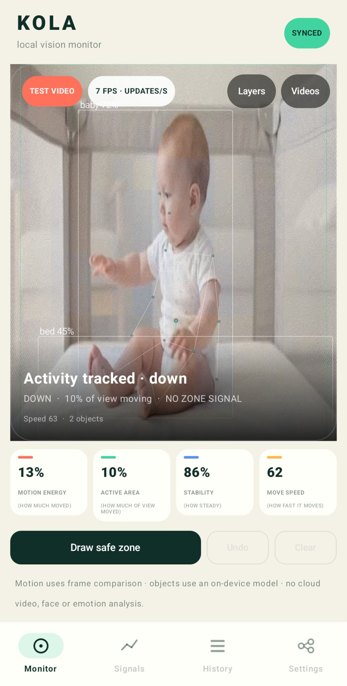
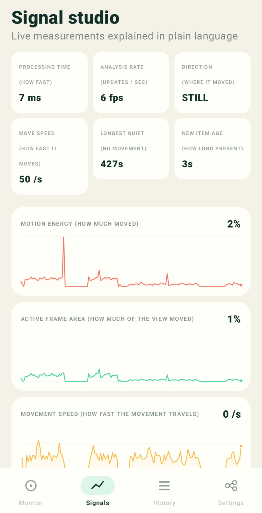
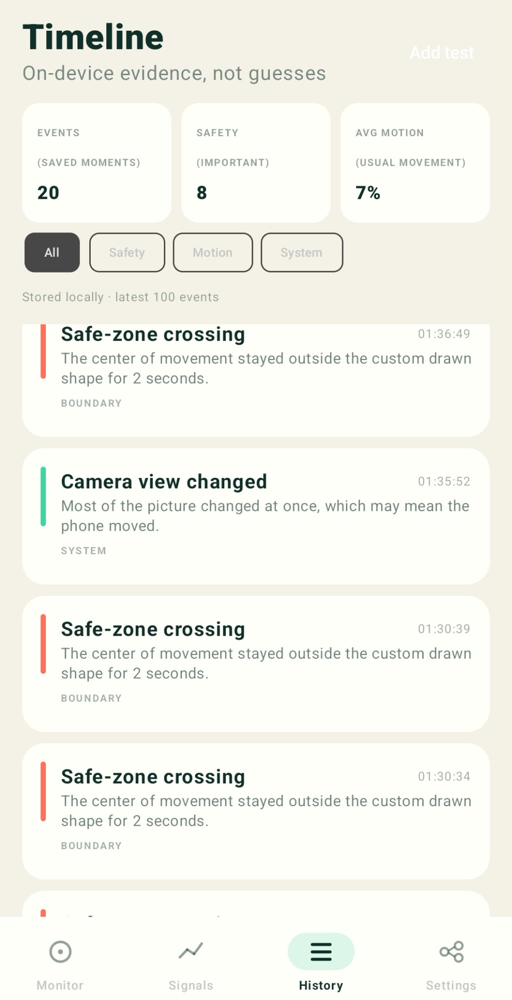
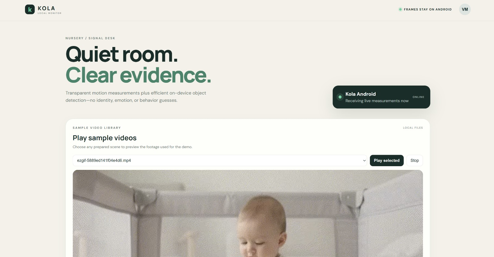
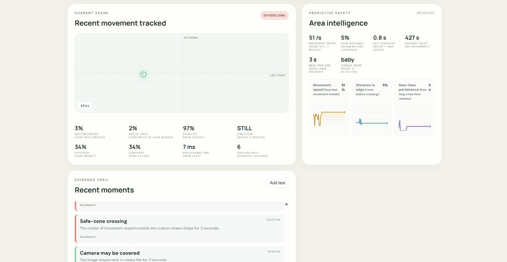
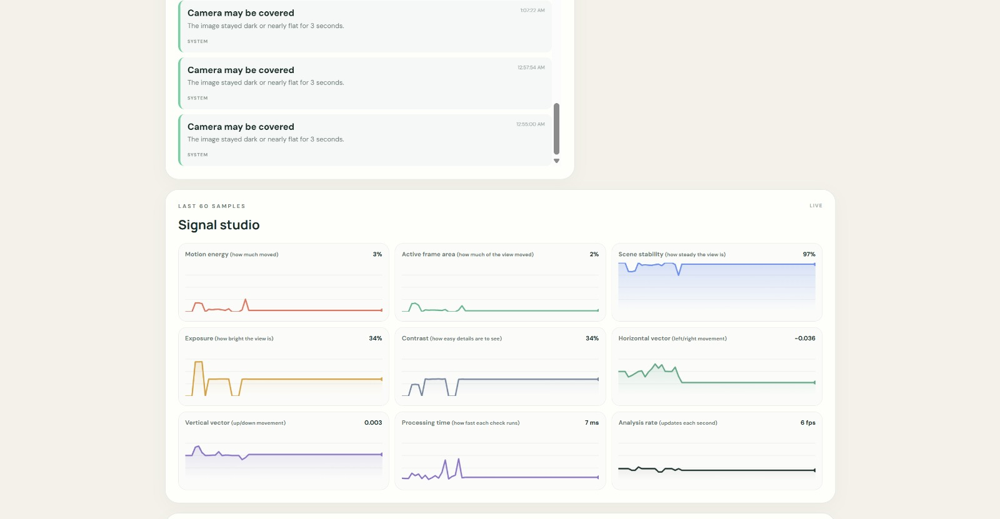
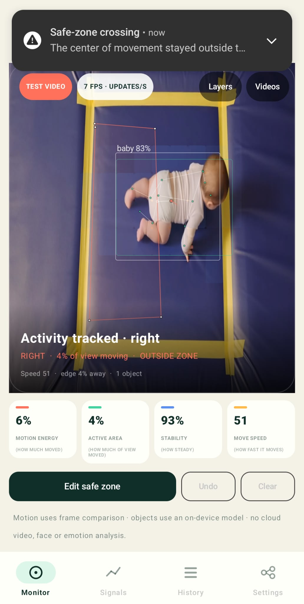

# Kola

**[Live dashboard](https://web-chi-two-3ke3ttj1ky.vercel.app)** · **[Android APK](https://drive.google.com/file/d/1O2MNI_M0R-juki2TWICV_GkmLz4MrNm4/view?usp=sharing)**

---

## The problem

A baby monitor can show a room, but it usually leaves the caregiver watching a silent video feed and deciding what matters. A boundary can be crossed, the camera can move, the view can become blocked, or a new object can remain nearby without a clear explanation.

Caregivers need earlier, understandable signals without sending intimate video to a remote service. This matters for parents, grandparents, babysitters, and childcare staff sharing responsibility.

## The solution

Kola turns an Android phone into a privacy-first area monitor and pairs it with a browser dashboard for shared caregiver visibility. The phone keeps video local and converts meaningful changes into simple signals: movement, quiet periods, safe-zone events, camera health, heatmaps, and persistent objects.

Kola is an awareness and workflow aid, not a medical device. It does not identify a baby, infer emotion, monitor breathing, prevent SIDS, or replace direct supervision.

## What the caregiver can do

- Watch a live camera or select a saved sample video from the same monitor screen.
- Draw a safe area around a bed, play mat, or any part of the room using an arbitrary shape.
- See whether movement is calm, active, still, moving left or right, or approaching the edge of the safe area.
- Receive an early boundary warning and a simple estimate of when an exit may happen.
- Turn individual camera layers on or off so the video stays readable.
- See a small, subtle body guide when pose information is useful.
- See objects that appear in the room and how long they have remained visible.
- Review an area movement heatmap to understand where activity has accumulated.
- Track movement speed, active area, longest quiet period, camera stability, brightness, and new-object persistence.
- Receive understandable notifications for boundary crossing, sudden movement, extended quiet, a moved camera, a blocked view, or a potentially unsafe item.
- Review a searchable evidence trail instead of continuously watching the feed.
- Share numeric measurements and events with a browser dashboard while the video remains on the Android phone.

## How Kola works

```text
Android camera or saved video
                |
                v
     Analyze each frame on the phone
                |
       +--------+--------+
       |                 |
       v                 v
 Measure movement    Check pose and
 and camera health   visible objects
       |                 |
       v                 v
 Compare movement    Track object
 with the custom     persistence
 safe zone               |
       |                 |
       +--------+--------+
                |
                v
  Create a clear event when a rule is met
                |
                v
 Update metrics, heatmap, and history
       ^
       |
       +-- movement and camera health also feed this step
                |
                v
 Optional numeric sync to web dashboard
                |
                v
 Caregiver sees charts, events, and settings
```

The phone turns video into small, explainable measurements first. The dashboard receives those measurements and events rather than raw camera frames.

## Product tour

| Monitor | Signals | History | Web dashboard |
| --- | --- | --- | --- |
|  |  |  |  |
| Live camera or saved video with subtle layers, pose guide, objects, and custom zones. | Movement speed, quiet time, processing time, update rate, and trend charts. | Searchable evidence trail for boundary, camera, motion, and system events. | Browser view of synchronized telemetry, charts, events, notification controls, and sample videos. |

| Predictive safety | Camera health | Evidence trail |
| --- | --- | --- |
|  |  |  |
| Distance to the drawn boundary, direction, speed, and predicted exit time. | Detects dark, blocked, or shifted views so quiet footage is not mistaken for a healthy signal. | Alerts are debounced and explained in plain language, with independent notification switches. |

## Technical explanation

### Android vision pipeline

- Kotlin, Jetpack Compose, CameraX, and Kotlin Coroutines provide the monitor UI and responsive capture pipeline.
- A 32x24 luminance grid is compared frame-to-frame for deterministic motion analysis.
- Adaptive difference thresholds estimate motion energy and active area.
- Weighted centroids estimate movement location; bounding regions describe the changed area.
- Exponential smoothing stabilizes direction and speed readings.
- Broad-frame change rejection separates camera movement from local activity.
- A decaying 16x12 spatial accumulator produces the area movement heatmap.
- Arbitrary 3-16 point polygons use point-in-polygon testing and point-to-segment distance.
- Predictive boundary timing projects the current direction and speed forward in small steps.

### On-device models

- EfficientDet-Lite0 through TensorFlow Lite Task Vision provides compact object detection.
- ML Kit Pose Detection runs in stream mode and supplies body landmarks; Kola renders a reduced set of useful anchors to keep the view legible.
- Object persistence is tracked over time so a brief detection is not treated the same as an item that remains visible.

### Synchronization and web

- The Android app sends structured numeric telemetry and events through a small JSON API.
- Server-Sent Events update the local browser dashboard without sending raw camera frames.
- The web interface uses HTML, CSS, vanilla JavaScript, Canvas charts, and a Node.js server.
- Static showcase mode provides seeded telemetry and bundled sample videos for presentations when no phone is connected.

### Privacy model

Raw frames are analyzed on the Android device. The synchronization layer contains measurements, event descriptions, settings, and timestamps rather than camera footage. The project has no LLM, face-recognition system, emotion classifier, or cloud-video processing path.

## Future direction

The next phase is to make Kola robust enough for longer real-world use and supervised childcare environments:

1. Collect consented, diverse, privacy-preserving video and telemetry data covering overhead, side-angle, low-light, partial occlusion, different rooms, and different camera positions.
2. Add confidence calibration, replay-based regression tests, per-device performance profiling, and better fallback behavior when inference is unavailable.
3. Support multiple monitored children in a daycare room with separate zones, anonymous track IDs, occupancy counts, and no identity recognition.
4. Add privacy-preserving multimodal signals such as room audio energy, caregiver-defined sound events, camera health, and environmental sensors without uploading raw recordings.
5. Improve object safety coverage through a reviewed childcare-item dataset and transparent risk rules rather than unexplained labels.
6. Add durable event storage, authenticated caregiver accounts, encrypted transport, offline queues, and reliable reconnect behavior for production deployments.
7. Publish evaluation reports for false alerts, missed alerts, latency, battery usage, and performance across phone classes before making stronger safety claims.

## Running locally

### Android

```powershell
$env:JAVA_HOME='C:\Program Files\Tableau\Tableau 2026.2\bin\jre'
.\gradlew.bat testDebugUnitTest assembleDebug
adb install -r app\build\outputs\apk\debug\app-debug.apk
```

### Web dashboard

```powershell
cd web
npm test
node server.mjs
```

Open `http://localhost:8787`. For another device on the same network, use the laptop's LAN address and port `8787`. The Android app can send numeric telemetry and events to that URL; video remains on the phone.

## Honest limits

The object model's COCO `person` result is presented as `baby` in the single-infant demo context. It is not age or identity classification. Object risk labels are transparent caregiver-review rules, not universal safety judgments. Motion can come from caregivers, bedding, lighting, pets, shadows, or camera movement.

## Privacy and repository hygiene

This repository contains source code, test assets, and anonymized UI captures only. It does not contain API keys, account tokens, local machine configuration, Android signing secrets, or private user data. Generated build output and local environment files are excluded by `.gitignore`.

## Project layout

- `app/` - Android monitor, on-device vision, zones, alerts, history, and sync.
- `web/` - responsive dashboard, static judge mode, sample videos, and local sync server.
- `docs/screenshots/` - presentation-ready product captures used above.
- `TEST_VIDEO_PROMPTS.md` - prompts used to create broad posture and camera-angle coverage.
- `HACKATHON_STRATEGY.md` - product research and pitch planning.
